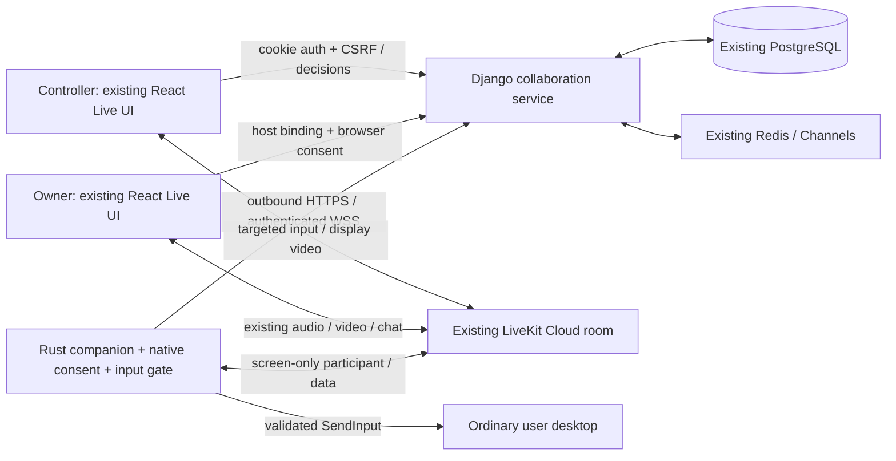

# C. Architecture decisions

Decisions are proposed for architecture-owner review; implementation contracts in this pack are the default. Change them through an ADR, not ad hoc coding-agent choices.

## ADR-01: Extend existing collaboration, never meeting identity

Use `sessions_app` for collaboration services and existing RemoteControlGrant. A typed `SessionRef {kind,id}` resolves group, private, live and skill through a common **authorization adapter**, not a new database meeting table. Group/instant launches first. The adapter must preserve all existing course, batch, learner profile, guest entitlement, lobby and removal gates. Unknown contexts are disabled. Public audience/spectator membership never authorizes a request.

## ADR-02: Server-assisted coordination, native endpoint

No high-frequency input goes through Django. Control-plane traffic uses existing ASGI/Redis. An isolated collaboration WebSocket is justified because its lifecycle/credentials differ from chat and must not change attendance or keep meetings alive. It is additive within the same backend, not another service. Existing chat sockets continue untouched except legacy control events cease granting authority.

Companion LiveKit identity: `rcdev:<device_uuid>:<binding_uuid>` generated server-side. It is visible as “Alice’s desktop — Remote Companion”, tied to Alice in UI, excluded from human counts/attendance/billing entitlement and normal people controls. Actual LiveKit cloud connections remain billable. Do not use a hidden participant. **Native token (revised 11 November 2026 — supersedes the original grant):** `room_join` true; `can_publish` true with screen_share only; `can_publish_data` true; **`can_subscribe` true**; no microphone, camera, admin, recorder or agent privilege. Tokens have 60-second join TTL; validity of an existing connection is not bounded by that TTL, so native leases remain mandatory.

The original grant said `can_subscribe: false` "for media". **That participant cannot exist.** LiveKit has no separate grant for receiving data — `canSubscribe` governs tracks generally, and upstream treats data surviving its revocation as a bug — so the companion as first specified would have received no input at all. Evidence: [evidence/sdk-capability-findings.md](evidence/sdk-capability-findings.md). Options and trade-offs: [adr-02-revision-proposal.md](adr-02-revision-proposal.md), Option C adopted.

**Media isolation is therefore client-side, and that must be stated plainly rather than implied away.** The companion connects with auto-subscribe disabled, subscribes to no track, and instantiates no audio sink or decoder. A server-signed claim no longer enforces this; our own code does. That is an acceptable trade *only* because the threat model already places a maliciously modified companion outside the guarantee — the token never defended against our own binary. It defended against something else holding the credential, and that risk is unchanged and now carries its own threat-register row.

**Authority lives in the payload, not in the SDK's sender field.** The companion authorises input on the signed epoch, nonce freshness and sequence floors it can verify itself; SDK-reported sender identity is defence-in-depth, used when present. This is deliberate: the Rust SDK drops the sender whenever participant lookup misses, including the ordinary join race, and the upstream fix is unmerged. A packet the SDK cannot attribute is rejected on its own merits — for failing verification, not for lacking a name — so the invariant no longer depends on an upstream release.

**Still to verify in RC-003:** that the Rust SDK exposes an auto-subscribe-off connect option and that declining subscription is durable. If it is not, fall back to Option B (input over the existing authenticated Django WebSocket), which restores server-enforced isolation at a capacity cost on infrastructure already identified as the bottleneck.

## ADR-03: Capture ownership provides coordinate safety

A browser `getDisplayMedia` track cannot reliably identify the physical display or OS coordinate origin. A tab/window image cannot safely map to arbitrary applications. No heuristic based on matching resolutions or user-entered offsets in the MVP.

For assistance, local companion selects **one complete display**, shows scope, starts native capture and publishes a screen-share track in the existing room. UI swaps focus to that verified track; browser screen sharing is explicitly stopped only after a visible handoff. Track SID, capture generation and display mapping are bound to the host binding and grant. Other meeting tracks remain unchanged. All usual room viewers can see this full display; consent must disclose that. If a room is publicly broadcast or recording status is unknown, disable assistance for MVP; do not imply pair-private video.

## ADR-04: Independent local consent + expiring authority

Browser approval is intent; local native Allow is the last authorization step. The companion fetches the authoritative request, validates signed activation and a current lease, binds to a display it captured, then opens its input gate. Local pause/stop and physical emergency controls are enforced before processing queued network messages. One controller/device across all rooms. Account/admin privilege never grants local control. A local-stop latch cannot be reopened by a stale server response.

## ADR-05: Minimal UI/core, bounded platform expansion

Rust workspace with a protocol/state crate, platform adapters and native shell. Windows MVP uses Win32 native controls via the `windows` crate so accessibility and trusted physical event handling can be tested without a browser webview. No requirement for every OS to share its UI toolkit. macOS native UI and Linux toolkit adapters reuse the core. Tauri is a fallback if measured maintenance/accessibility costs favor it; never load remote web content into a privileged shell.

## ADR-06: Files are a separate capability

Remote-control permission never grants filesystem APIs, clipboard sync or automatic uploads/downloads. A controller can nevertheless operate Explorer/VS Code/terminal through normal UI and can read/change user-accessible files: **that is inherent in genuine desktop control**. Do not advertise it as an application sandbox. No hidden command execution channel, remote file enumeration, shell API, privilege escalation or unattended access.

Existing room files retain their meaning. Add private peer transfer consent/metadata and targeted streams. Native file transfer adds little MVP value; defer until browser limits are measured. Optional durable files reuse existing private media authorization patterns and async jobs but require a recipient ACL and quarantine storage.

## ADR-07: Do not promise E2EE by using WebRTC

TLS and WebRTC transport encryption protect links; LiveKit/backend are trusted infrastructure in MVP. Current LiveKit documents opt-in E2EE features [S13], but SDK interoperability and key distribution are not implemented here. Do not publish a blanket E2EE claim for media, packets, files or signaling. Targeted delivery prevents normal room recipients receiving payloads, not the SFU inspecting them. Optional future E2EE needs a separate key-management/recovery/recording ADR.

## Open decisions requiring a named human owner

These are **not** decided by this pack. An ADR records an engineering choice; the items below are product, policy or safeguarding choices that an architecture reviewer is not the right person to settle alone. Each names what it blocks. Do not let an implementation task resolve one by default.

### OD-01: Does a student get to request control of another student's desktop?

The rest of the pack assumes yes — ADR-01 authorizes through participant membership, "never teacher privilege", and the acceptance scenarios demand a Student A↔Student B demo. That is defensible as architecture: it avoids baking a role hierarchy into a consent system, and teacher-initiated control carries its own coercion problem, arguably a worse one given the authority gradient.

It is still an unmade decision, because the existing code deliberately went the other way. `sessions_app/remote_control_views.py` requires real teacher context and documents why. Widening it means a K-12 platform ships a mechanism for one minor to operate another minor's computer, with the consent dialog as the only thing in between. The relevant risk is the coercion case in [permission-security-model.md](permission-security-model.md), which no control in this pack reduces.

Options, honestly stated: (a) peer-to-peer with the hardened consent dialog, (b) teacher-initiated only for MVP, deferring peers until there is incident data, (c) peer-to-peer gated on an admin or guardian setting, defaulting closed.

**Blocks:** RC-011 (consent UI), RC-016 (end-to-end acceptance), RC-021 (classroom policy). RC-002 can freeze schemas without it provided the authorization adapter keeps the requester-role predicate pluggable rather than hardcoding either answer.

### OD-02: Audit retention for consent and session records

[permission-security-model.md](permission-security-model.md) proposes a 90-day default and says the final policy needs approval before release. Unresolved. **Blocks:** RC-030.

### OD-03: Behaviour when recording status is unknown

ADR-03 disables assistance when a room is publicly broadcast or recording status is unknown. Whether that is the shipped behaviour or a placeholder for a disclosure UX is a product call. **Blocks:** RC-021, RC-029.
