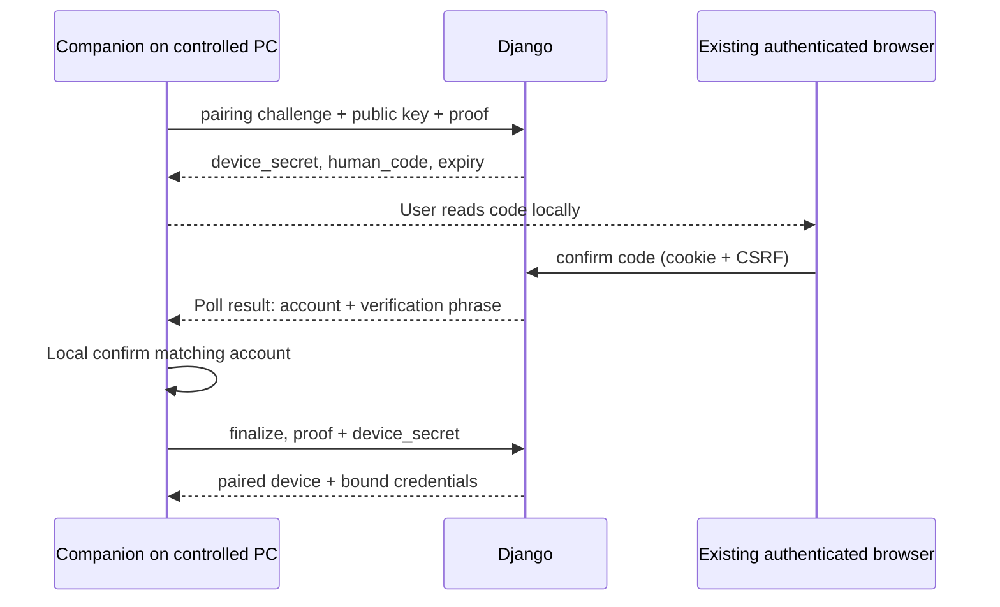

# D. Native companion

## Modules and process boundaries

Proposed new sibling repository/workspace path: `shiksha-remote-companion/`. Do not bury native releases in a React build. One per-user process, manually launched or explicit opt-in login startup; no system service. Proposed crates: `protocol` (strict parsing/fixtures), `core` (grant/lease gate), `transport` (HTTPS/WSS and LiveKit), `platform-windows` (input/capture/native UI), later `platform-macos` and `platform-linux`, and `app` (composition). A small release/update helper may run only during an explicitly scheduled update, never as an input service.

Pin Rust toolchain, crates and LiveKit/libwebrtc build artifacts by version/checksum in RC-003. Do not select a wrapper solely on claims of small size. Use Tokio with bounded queues; native UI thread, network tasks, capture worker and a single serialized input executor. UI stop uses an atomic generation/latch read immediately before every OS injection; revoke increments generation and clears queued work. A watchdog runs independently of capture/network queues. `Drop` cleanup is useful but cannot handle abrupt process termination by itself.

Input executor owns the set of **remotely** pressed keys/buttons, never a global key logger. On stop, pause, stale lease, stale controller, permission loss, display change, window blur at controller, panic caught at task boundary, or transport interruption: close gate, discard queued input, release owned pressed states. Limit held key/button duration to 10 seconds without a fresh state confirmation; no hold survives a terminated grant. Physical key state must be considered before injecting releases to avoid cancelling locally held modifiers. Test simultaneous physical/remote inputs, not just synthetic unit events.

For abrupt process kill, OS behavior is not a reliable release guarantee. Windows adapter spike must demonstrate cleanup using a minimal same-user watchdog/helper with a pipe-death signal, or show the platform reliably clears this process's injected holds. If neither can be demonstrated, ship no indefinite held keys/buttons: restrict to bounded input gestures until a reviewed cleanup mechanism exists. This is a release gate, not a promise that destructors solve crashes. Helper has no network API or authority to open the input gate.

## Pairing (installation is not consent)

Use existing browser login. Companion creates a P-256 key in OS-protected storage and creates a 5-minute pairing challenge with a DPoP proof. Server returns a 256-bit device secret (poll capability) and a random 10-character human code from a 32-symbol alphabet. Store only a keyed hash of that secret/code server-side. No bearer credential in browser URLs.

User opens Shiksha settings, enters code, sees device name/OS/public-key fingerprint and confirms. This reserves association to the authenticated account/context. Companion displays the account's server-verified display name and short verification phrase; local user confirms the match. Server rechecks the confirmed browser auth session/account/context is still valid at finalization. Only then server creates PairedDevice and issues a device refresh credential bound to its key. Pairing secret has no other API authority; at most five code attempts, per-IP/user/device throttles, and one-time atomic redemption. Local final confirmation prevents merely knowing someone's account session from silently pairing a remote computer.

DPoP profile: RFC 9449, `typ=dpop+jwt`, ES256 only, public JWK in proof header; validate htu against the externally configured canonical HTTPS endpoint (not untrusted forwarded headers), htm, iat ±30s, server nonce, unique jti cached 2 minutes, and ath on resource requests. Access token `typ=shiksha-device+jwt`, issuer `https://api.shikshacom.com`, audience `shiksha-companion-api`, sub=device UUID, owner UUID, cnf.jkt, scopes, exp ≤5 minutes. Refresh credentials are random 256-bit opaque values, stored hashed, expire in 30 days, rotate atomically on use and detect reuse; device key proof is required to refresh. These are subordinate credentials; they cannot call ordinary user APIs or approve browser consent.

Server signing keys are distinct from SimpleJWT and LiveKit secrets. Companion validates signed control tickets against a pinned trust root/configured key set, algorithm allowlist, kid, issuer, audience and time. Key rotation overlaps bounded validity and signed update trust; fail closed for unknown key. Use audited JWT/DPoP libraries and shared conformance fixtures. Do not implement elliptic-curve cryptography manually.

## Detection, host binding and local authority

Browser GET devices shows `online` only if outbound companion status heartbeat is ≤15 seconds old. Idle companion uses 10-second heartbeat; it does not join any LiveKit room until locally enabled. A browser creates a host binding to a specific paired device and existing SessionRef; native UI independently verifies room, account/context, sharing scope and chooses display. Native confirms, then obtains a screen-only token and reports verified track SID/capture descriptor. This is consent to **share**, not control. Without that local action, an online device cannot be commanded to publish its desktop.

Each control request shows the server-verified controller name, context/profile, meeting title, this device and display, capabilities, expiry and Stop instructions. Browser Allow changes REQUESTED→APPROVED; companion local Allow calls activation and latches the approved epoch only after server reply verifies. Device key possession alone cannot authorize any grant. Account switch, logout, device unlink and OS user/session switch close binding and grants.

Native approval dialog must be protected from remote input. It cannot be clicked by injected events. Initial grant starts closed; resume/renew/pair/update dialogs close all input before display, discard queued events and accept only physical local interaction where distinguishable. On Windows mark own SendInput events and reject injected input for these controls. Deny browser-triggered programmatic activation of native commands. No new consent dialog opens while another grant can inject. If a platform cannot enforce this distinction, require fresh platform-mediated physical consent and keep the gate closed.

## Capture/input adapters

API contracts (Rust interfaces, proposed): `CaptureAdapter.select_locally() -> DisplayDescriptor`, `start() -> frame stream`, `stop()`; `InputAdapter.capabilities()`, `inject(ValidatedEvent)`, `release_owned_inputs()`, `register_emergency_stop()`. No adapter accepts network JSON directly. ValidatedEvent is constructible only by core authorization/validation code.

Windows: WGC capture bound to selected monitor; per-monitor DPI awareness v2; SendInput normalized virtual desktop coordinates, scan codes for physical keys, Unicode for explicit text. Keyboard mapping and short cuts must be tested. Capture adapter records physical bounds/rotation; encoder resizing never changes desktop bounds. Detect input desktop changes/UAC/lock, pause then terminate; no elevation request. Native overlay/tray “Controlled by …” with Stop; Ctrl+Alt+Shift+F12 physical hotkey, configurable during setup if unavailable. Failure to register an effective emergency control blocks activation.

macOS: ScreenCaptureKit + Accessibility trust check/CGEvent adapter; native points/pixels and screen origins converted explicitly. Linux: X11 XTEST only in X session; Wayland portals/PipeWire/libei via version-probed adapter. Do not bypass desktop consent with root helpers. Follow [platform matrix](feasibility-platform-matrix.md).

## Size/performance budgets and measurement

No installer exists; all numbers below are **engineering targets**, not estimates backed by benchmarks. Desired compressed installer <30 MB; review over 60 MB rather than deleting safety/UI features. Installed target <150 MB, idle working set <80 MB, active <250 MB, idle CPU <1% of one reference CPU core, 1080p15 capture <20% of that core with hardware encoding where available, cold startup <3s. Hardware, encoder and SDK determine results; active CPU target may be missed.

RC-003 must build a release Windows spike with native RTC/capture and measure signed/unsigned/compressed/installed bytes, dependencies, 5 cold starts, idle and 20-minute active RSS/private bytes/CPU/GPU/p95 latency on named hardware. Do not claim “pure Rust” means no C++ runtime: LiveKit RTC includes native WebRTC dependencies. Compare native UI vs Tauri only if necessary; include WebView2 disk/RAM when measuring Tauri.

## Distribution and update

Windows signed per-user installer/uninstaller; Authenticode identity and timestamp, reproducible dependency manifest/SBOM. macOS Developer ID signing/notarization; Linux signed repository/package and documented dependencies. No service install, firewall exception or elevation by default. Register optional launch URI with fixed command and input length limits; no shell interpolation.

Update manifest: version, monotonic release sequence, OS/arch, artifact SHA-256/size, minimum compatible protocol, release expiry and detached signature. Verify manifest signature and artifact signature/hash before execution; reject rollback except an explicitly signed recovery release. Root keys offline; publish staged channels. Download in background if opted in; install only after control/sharing stops, with visible notice. Server kill switch may disable vulnerable clients but cannot force unattended input/update execution. Uninstall stops capture, closes grants, removes keys/startup/URI entries and paired-device association when online; if offline, delete local keys and expose remote unlink in account settings. Do not remove user-selected downloaded files.

Local input priority: a physical mouse/key activity notification (without retaining key values) pauses remote injection and releases remote-owned states. The OS adapter differentiates its injected events from physical activity; never use an unfiltered global key logger. On systems where provenance cannot be established, retain reliable Stop controls and disable automatic physical-activity pause rather than guessing. Default policy must be shown during setup and covered by platform tests.
