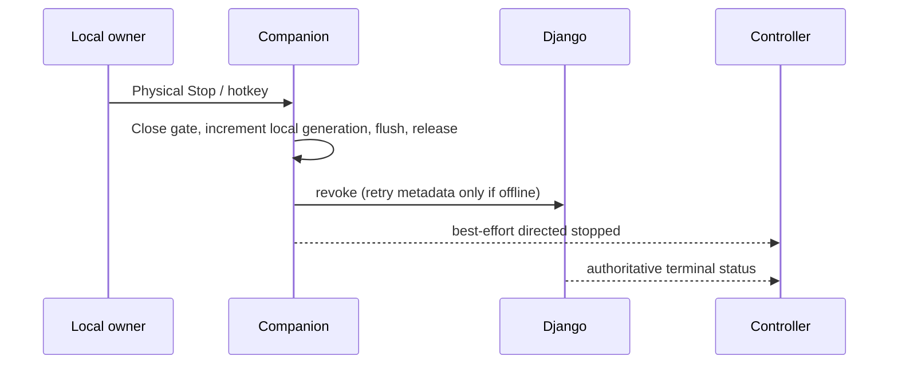
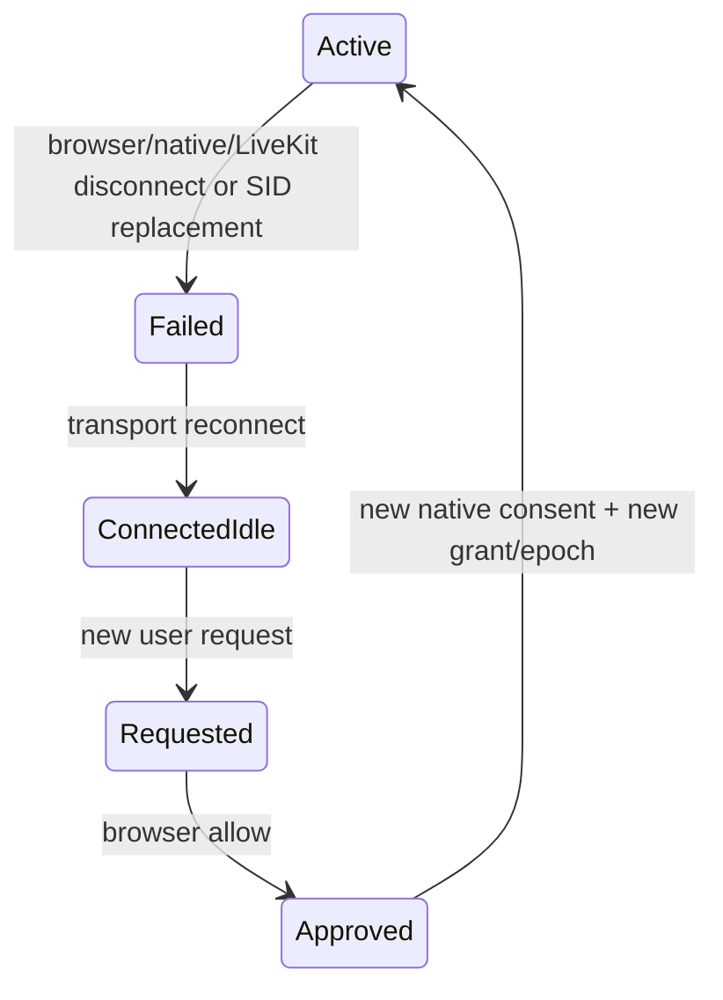

# E. Remote-control state and authorization protocol v1

Normative constants shared by Python/Rust/JS implementations. Wire shapes: [realtime](realtime-event-contracts.md); routes: [API](api-contracts.md). All timestamps are UTC RFC3339; wall clocks are never the sole local timeout mechanism.

## Policy prerequisites

Resolve SessionRef server-side to its existing model and room. Both users must be authorized **interactive** participants, with current verified LiveKit participant identity + SID + fresh browser binding. No enrollment requirement for instant meetings. Course adapter retains enrollment/batch/removal checks; broadcasts/spectators cannot request or host control. Existing role badges are display only. Same-account profiles are distinct contexts; MVP denies controlling another profile of the same account to avoid identity ambiguity. This does not restrict different student accounts.

Owner's browser binding, companion host binding, current capture SID/generation, and controller binding must all remain valid. `ParticipantBinding` is a Redis record renewed every 2s with TTL 6s and a current LiveKit SID verified by server room query on attach and at most every 2s while active, plus signed webhook invalidation. If LiveKit verification fails or is stale >3s, stop renewing control leases. Use coalesced room queries, not one query per event. Browser heartbeat proves this UI still exists; it is not alone proof of LiveKit membership. While a grant is active, last browser and native binding heartbeat must be ≤3s old for lease renewal, even though Redis retains the record for6s. This makes the missed-disconnect budget below explicit.

On each lease renewal recheck DB session terminal/removal/entitlement state, device revocation, grant state/version and fresh presence. Never rely solely on initial join. Global flag-off invalidates new leases. Backend dependencies unavailable means no renewal.

## State model (stored lowercase)

`requested`, `approved`, `active`, `paused`, `declined`, `revoked`, `expired`, `completed`, `failed`.

| From | Trigger/actor | To | Required atomic effects |
|---|---|---|---|
| none | eligible controller request | requested | Bind immutable principals/device/context; expiry=request+60s |
| requested | target browser deny | declined | End timestamp/audit; no native permission |
| requested | target browser allow | approved | Lock device; reserve unique slot; approved deadline ≤30s |
| approved | physical native allow + valid prerequisites | active | Increment epoch; set grant expiry=min(now+10min, room hard end); signed activation + first lease |
| active | owner local pause / either UI pause / controller blur | paused | Close gate first if local; release; bump epoch; hold reservation ≤60s |
| paused | target browser resume intent AND native local confirm | active | Revalidate all; fresh epoch/lease; reset input sequences; retain original hard expiry |
| nonterminal | target/device/controller cancel, moderator terminate, device unlink or flag off | revoked | Increment version/epoch; revoke reason; dispatch after commit |
| requested/approved/paused/active | deadline elapsed | expired | Release device slot; no renewal even if cleanup job late |
| active/paused | normal controller finish or meeting end | completed | Release/close; normal terminal audit |
| approved/active/paused | disconnect, SID change, capture loss, crash or protocol violation | failed | Close/release immediately; reason `disconnected`, etc. |

Terminal rows never reactivate. Reconnect means a **new** request, browser approval and native consent. `disconnected` is a terminal reason, not a resumable state. `approved` is not a permission to inject. `paused` cannot survive a network disconnect or fresh browser page. All transitions use `expected_version`, `select_for_update`, a device-row lock and DB partial uniqueness for approved/active/paused across rooms. Requesting does not reserve a device. Approval checks expiry inside the transaction.

## Lease and local gate

Activation ticket (server-signed JWT, EdDSA/Ed25519, fixed `typ=shiksha-control+jwt`) includes iss, aud=`shiksha-remote-companion`, jti/grant UUID, grant_version, epoch UUID, SessionRef, room_name, controller and target user UUIDs/context snapshots, controller identity/SID, host browser identity/SID, device UUID/key thumbprint, host_binding UUID, companion identity/SID, capabilities, capture_generation, track_sid, display_id, created_at, iat, nbf, exp, protocol=1. `exp` is grant hard expiry, **not** a replacement for a current lease. Reject unknown algorithms/kid, future nbf, wrong fields and capability supersets. Never put this ticket in LiveKit room metadata or logs.

`POST grants/{id}/lease` is device-authenticated every 1s. Request carries epoch, version and a fresh random nonce. Signed lease (`typ=shiksha-control-lease+jwt`) binds ticket hash, grant/epoch/version/device, lease_seq, nonce, iat and exp ≤iat+3s. Only a response to the currently outstanding nonce can renew. Discard responses taking >1s. Companion records monotonic request start; deadline is **min(request_start+3s, validated server exp translated conservatively)**, never receive_time+3s. Reject lower/equal lease_seq. Reject all late responses after local stop/generation change. Never issue future-dated or prefetchable leases.

This bounds authority for a revoked grant to ≤3s from its last authorized request start, excluding OS scheduler stalls; test stall behavior and check deadline immediately before injection. Target local Stop has no server round trip. Backend HTTP revoke acknowledgement means DB authority revoked, not proof remote device has received it; UI distinguishes “stopped on device” vs “revocation pending; lease expires within 3s”. Membership disappearance may take up to 3s to detect plus remaining lease, so budget ≤6s for a missed remote disconnect; direct transport disconnect ends immediately. No false promise of instantaneous global revocation.

Companion opens gate only when: native consent latch set for this epoch, server state active, current activation valid, lease fresh, local session unlocked, capture descriptor current, controller heartbeat fresh, sender/sequence valid and capabilities permit event. Every event rechecks the gate at injection time.

Controller sends a reliable heartbeat every 250ms. Companion sends a rolling random freshness challenge every 250ms, valid ≤1s monotonic; every input/heartbeat echoes a still-valid challenge. This prevents reliable backlog from executing old input after congestion without trusting controller clock. If no valid controller heartbeat for 1s, pause, release; require local resume. RTT >1s makes control unavailable; normal meeting remains usable. Rate-limited input queues hold ≤128 messages and no event past challenge expiry.

## Approval sequence

```mermaid
sequenceDiagram
  participant B as Controller browser
  participant D as Django
  participant H as Owner browser
  participant C as Native companion
  B->>D: request (verified participant/device/capture binding)
  D-->>H: private request notification
  H->>D: browser allow, expected_version
  D-->>C: approved request available
  C->>D: fetch authoritative request
  C->>C: Local physical Allow; display/capabilities shown
  C->>D: activate (device proof, consent_nonce)
  D-->>C: signed activation + lease
  C-->>B: targeted ready + freshness challenge
  B->>C: LiveKit directed input (grant/epoch/challenge)
  C->>C: Validate gate and inject real OS input
```

## Stop and reconnection





No input replay, pressed-state replay or grant resurrection on reconnect. LiveKit SDK transparent reconnect events are treated as loss of authority even if room identity remains the same. On sleep/resume, discard leases and pending packets. Recording/screen-share continuation follows explicit native sharing consent; terminal control does not silently restart browser capture.

## Local stop ordering and return semantics

Close the generation latch before enqueueing cleanup; the single injection executor observes it under the same dispatch synchronization before starting each OS call. A call already dispatched before Stop may complete; it cannot be retroactively undone. Native Stop acknowledgement is issued after the gate is closed and owned-state release has run. Do not assert that zero prior in-flight OS effects can occur after the physical button edge. After stopping, no queued/new input is dispatched.

## Session policy matrix

| Existing context | Eligible participant policy | Default assistance |
|---|---|---|
| Instant/general GroupSession | Authenticated current interactive participants admitted under existing link/lobby/entitlement policy, independent of student/teacher/admin/guest label | Pilot enabled after local host setup |
| Scheduled GroupSession | Existing host and accepted invitees, currently connected; preserve course-related invite constraints | Pilot enabled after local host setup |
| PrivateSession | Existing teacher/requester/accepted group-type participant policy plus current binding | Disabled until RC-020 |
| LiveSession classroom | Existing profile/batch/enrollment/removal checks plus explicit interactive-assistance opt-in | Disabled until RC-021 |
| Public broadcast / spectator | Audience/subscribe-only status confers no request/control rights | Disabled; audience cannot opt itself in |
| SkillSession | Confirmed booking and correct expert/learner profile plus current binding | Disabled until RC-022 |

An authenticated GUEST admitted interactively can be eligible; an anonymous viewer cannot. A TEACHER or ADMIN still needs the same local device-owner approval. Moderation can stop access for safety but cannot grant it.
