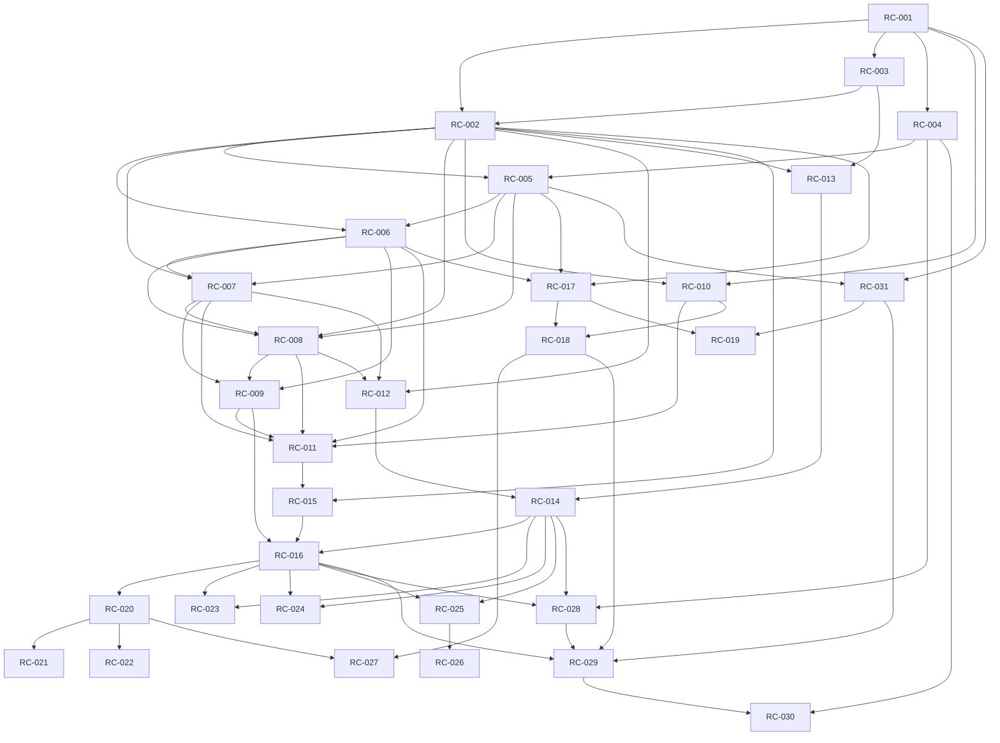

# M. Task dependency graph and execution prompts

Tasks are bounded implementation prompts. Existing paths were checked; new paths are explicitly planned. [RC-001](tasks/phase-0/RC-001.md) is the first executable assignment. Contracts freeze in RC-002 before dependent implementation. No coding agents were run during this architecture stage.

| Task | Phase | Goal / prompt | Dependencies |
|---|---:|---|---|
| RC-001 | 0 | [Lock the existing meeting compatibility baseline](tasks/phase-0/RC-001.md) | none |
| RC-002 | 1 | [Freeze schemas and cross-language fixtures](tasks/phase-1/RC-002.md) | RC-001, RC-003 |
| RC-003 | 0 | [Prove Windows native RTC capture and input feasibility](tasks/phase-0/RC-003.md) | RC-001 |
| RC-004 | 0 | [Reconcile runtime and deployment baseline](tasks/phase-0/RC-004.md) | RC-001 |
| RC-005 | 1 | [Add collaboration schema and migration constraints](tasks/phase-1/RC-005.md) | RC-002, RC-004 |
| RC-006 | 1 | [Implement group participant bindings and CSRF boundary](tasks/phase-1/RC-006.md) | RC-002, RC-005 |
| RC-007 | 1 | [Implement paired-device credentials and lifecycle](tasks/phase-1/RC-007.md) | RC-002, RC-005, RC-006 |
| RC-008 | 1 | [Implement consent state machine and bounded leases](tasks/phase-1/RC-008.md) | RC-002, RC-005, RC-006, RC-007 |
| RC-009 | 1 | [Integrate companion room lifecycle and capture bindings](tasks/phase-1/RC-009.md) | RC-006, RC-007, RC-008 |
| RC-010 | 2 | [Establish shared collaboration source ownership](tasks/phase-2/RC-010.md) | RC-001, RC-002 |
| RC-011 | 2 | [Build assistance setup and consent UI](tasks/phase-2/RC-011.md) | RC-006, RC-007, RC-008, RC-009, RC-010 |
| RC-012 | 3 | [Implement native authenticated core and transport](tasks/phase-3/RC-012.md) | RC-002, RC-007, RC-008 |
| RC-013 | 3 | [Implement Windows display capture and input adapter](tasks/phase-3/RC-013.md) | RC-002, RC-003 |
| RC-014 | 3 | [Implement native consent and emergency cleanup](tasks/phase-3/RC-014.md) | RC-012, RC-013 |
| RC-015 | 4 | [Implement browser remote input engine](tasks/phase-4/RC-015.md) | RC-002, RC-011 |
| RC-016 | 4 | [Validate end-to-end group assistance](tasks/phase-4/RC-016.md) | RC-009, RC-014, RC-015 |
| RC-017 | 5 | [Implement private transfer consent service](tasks/phase-5/RC-017.md) | RC-002, RC-005, RC-006 |
| RC-018 | 5 | [Implement targeted browser streams and private-file UI](tasks/phase-5/RC-018.md) | RC-010, RC-017 |
| RC-019 | 5 | [Add optional durable quarantine transfer](tasks/phase-5/RC-019.md) | RC-017, RC-031 |
| RC-020 | 6 | [Add private-session authorization and UI adapter](tasks/phase-6/RC-020.md) | RC-016 |
| RC-021 | 6 | [Add opt-in classroom assistance policy](tasks/phase-6/RC-021.md) | RC-020 |
| RC-022 | 6 | [Add skill-session adapter without identity changes](tasks/phase-6/RC-022.md) | RC-020 |
| RC-023 | 6 | [Implement and certify macOS adapter](tasks/phase-6/RC-023.md) | RC-014, RC-016 |
| RC-024 | 6 | [Implement limited Linux X11 adapter](tasks/phase-6/RC-024.md) | RC-014, RC-016 |
| RC-025 | 6 | [Implement permissioned Wayland portal adapter](tasks/phase-6/RC-025.md) | RC-014, RC-016 |
| RC-026 | 6 | [Certify installed COSMIC portal support](tasks/phase-6/RC-026.md) | RC-025 |
| RC-027 | 6 | [Verify Flutter compatibility and optional receive flow](tasks/phase-6/RC-027.md) | RC-018, RC-020 |
| RC-028 | 7 | [Package signed companion and verified updates](tasks/phase-7/RC-028.md) | RC-004, RC-014, RC-016 |
| RC-029 | 7 | [Run safety, load and compatibility release review](tasks/phase-7/RC-029.md) | RC-016, RC-018, RC-028, RC-031 |
| RC-030 | 7 | [Prepare and exercise staged production rollout](tasks/phase-7/RC-030.md) | RC-004, RC-029 |
| RC-031 | 5 | [Harden existing room-file expiry and download behavior](tasks/phase-5/RC-031.md) | RC-001, RC-005 |

Independent tracks after contract freeze: backend/device services, shared UI and native adapters. Do not parallel-edit common models or schemas without one integration owner. Platform tasks and optional durable storage can follow the Windows/group pilot; they do not waive RC-028–030 release gates. RC-031 is existing room-file hardening, kept separate from private transfers.
